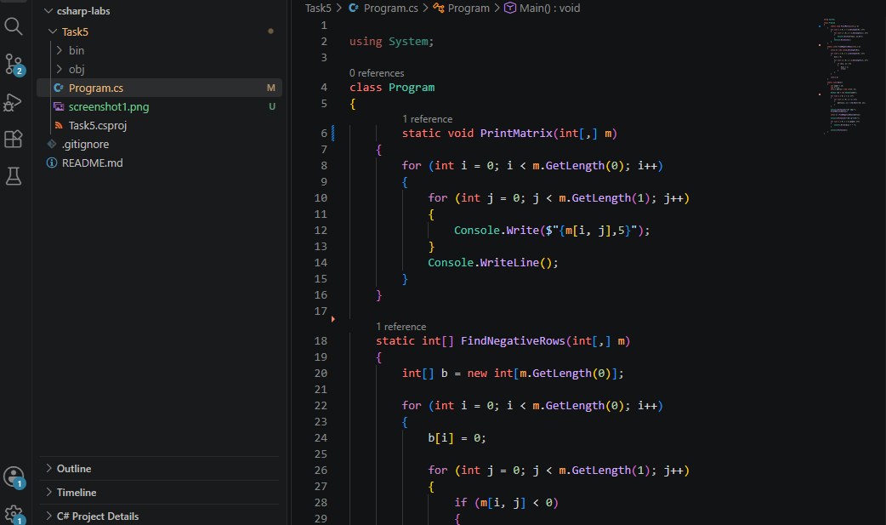
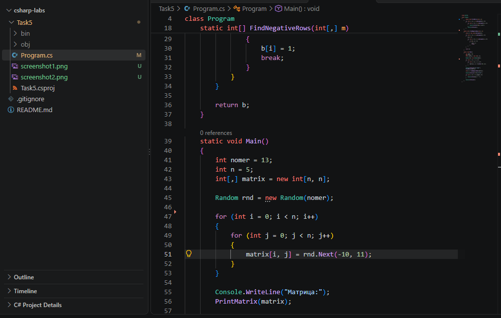
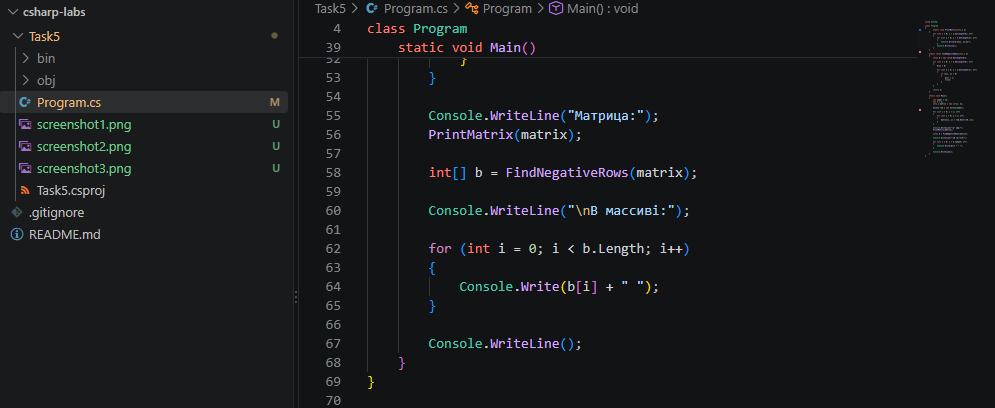
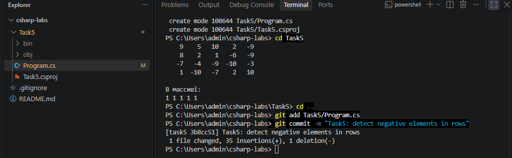
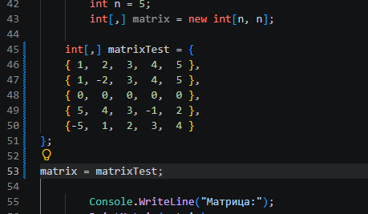
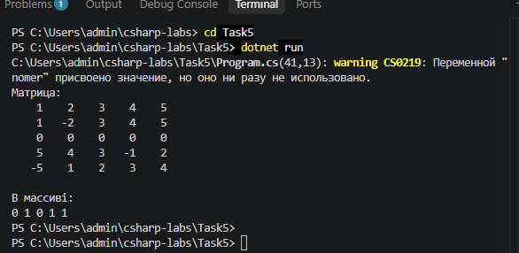
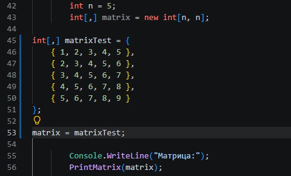
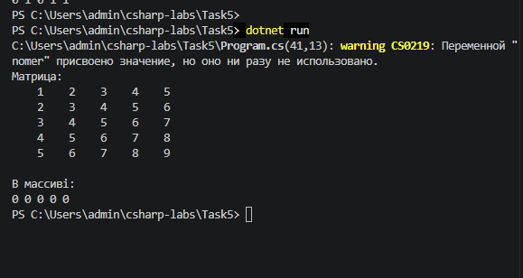

# 5-тапсырма. Екі өлшемді массивтер

**Студент:** Сұлтан Ұлболсын  
**Топ:** ИСк-25-3а  
**Тізімдегі нөмір:** 13  
**Нұсқа:** 2

## Жұмыстың мақсаты

C# тілінде екі өлшемді массивпен жұмыс істеуді үйрену.
Матрицаның әр жолында теріс элемент бар-жоғын анықтау.

## Тапсырманың шарты

5x5 өлшемді матрица құру керек.
Әр жолда кемінде бір теріс элемент болса, B[i] = 1.
Егер теріс элемент болмаса, B[i] = 0.

## Бағдарламаның алгоритмі

1. 5x5 матрица құрылады.
2. Матрица Random(13) арқылы толтырылады.
3. Әр жолдағы элементтер тексеріледі.
4. Теріс элемент табылса, B массивіне 1 жазылады.
5. Теріс элемент болмаса, B массивіне 0 жазылады.
6. Матрица мен B массиві экранға шығарылады.

## Бағдарлама коды

## Тестілеу нәтижелері

### 1. Жеке тест: Random(13)

Матрица Random(13) арқылы толтырылды.

Нәтиже: B = [1, 1, 1, 1, 1].

Әр жолда кемінде бір теріс элемент бар.

### Random(13) тест нәтижелерін салыстыру

| Жол | Қолмен есептелген B[i] | Бағдарлама нәтижесі B[i] |
|---|---|---|
| 1 | 1 | 1 |
| 2 | 1 | 1 |
| 3 | 1 | 1 |
| 4 | 1 | 1 |
| 5 | 1 | 1 |

Қорытынды: Қолмен есептелген нәтиже мен
бағдарлама нәтижесі толық сәйкес келеді.
Әр жолда кемінде бір теріс элемент бар.

### 2. Өз тестім 1

Матрицада теріс элементтері бар және жоқ жолдар берілді.

Күтілетін нәтиже: B = [0, 1, 0, 1, 1].

### 3. Өз тестім 2

Матрица тек оң сандардан тұрады.

Күтілетін нәтиже: B = [0, 0, 0, 0, 0].

## Бақылау сұрақтарына жауап

**1. matrix[i,j] деген не?**

i — жолдың индексі, j — бағанның индексі.

**2. GetLength(0) және GetLength(1) деген не?**

GetLength(0) — жолдар санын, GetLength(1) — бағандар санын көрсетеді.

**3. break не үшін қолданылады?**

Теріс элемент табылғанда ішкі циклді тоқтату үшін.

**4. Ішкі цикл неше рет орындалады?**

Матрицаны толтырғанда 25 рет. Теріс элементтерді іздегенде ең көбі 25 рет, бірақ break арқылы ертерек тоқтауы мүмкін.

## Кездескен қате және оны шешу

Бағдарламаны тестілеу кезінде CS0219 ескертуі пайда болды. Себебі `nomer` айнымалысы жарияланғанымен, тест кезінде қолданылмады. Бұл ескерту бағдарламаның жұмысына әсер етпеді. Тестілеуден кейін бастапқы `Random(13)` кодын қалпына келтіріп, мәселені шештім.

## ЖИ қолдану

ЖИ ды C# кодын орындауда сәл қолдандым және тапсырманы орындауда көмек сұрадым.

## Қорытынды

Бұл жұмыста C# тілінде екі өлшемді массивпен
жұмыс істеуді үйрендім. Матрицаның әр жолын
тексеріп, теріс элементтердің бар-жоғын
анықтайтын бағдарлама құрдым.
