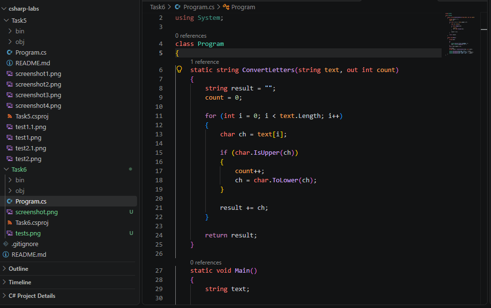
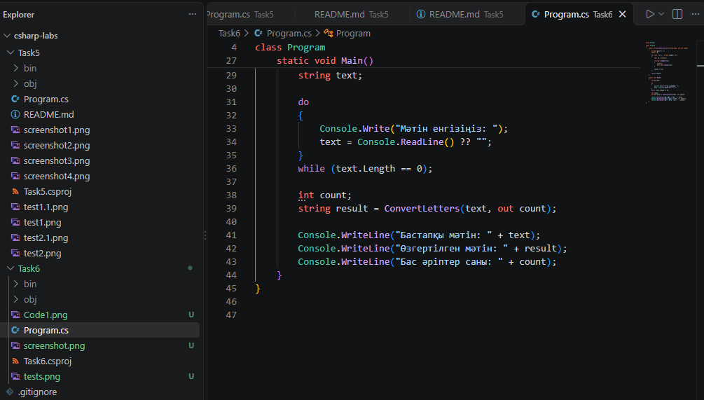
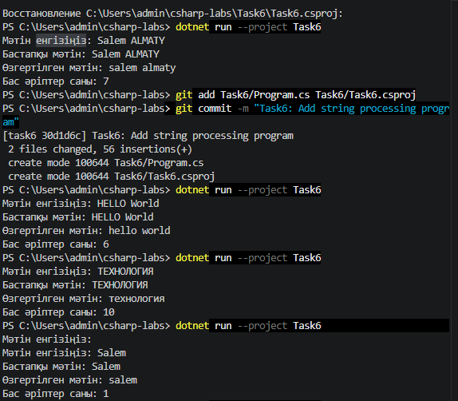
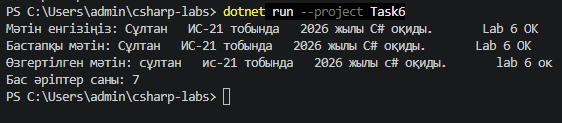

# 6-тапсырма: Символдар тіркесі (4-нұсқа)

## Жұмыстың мақсаты

C# тілінде мәтінмен жұмыс істеуді үйрену. Мәтіндегі бас әріптердің санын анықтап, оларды кіші әріптерге ауыстыру.

## Тапсырманың орындалуы

Бағдарламада мәтін `Console.ReadLine()` арқылы енгізіледі. `do-while` циклі бос мәтін енгізілгенде қайта сұрау үшін қолданылды.

`ConvertLetters()` әдісі мәтіндегі символдарды `for` циклімен бір-бірлеп тексереді. `char.IsUpper()` бас әріпті анықтайды, ал `char.ToLower()` оны кіші әріпке ауыстырады.

## Бағдарламаның коды





## Тестілеу нәтижелері



| Тест | Кіріс | Қолмен есептеген жауап | Бағдарлама жауабы |
|---|---|---|---|
| Негізгі тест | Salem ALMATY | salem almaty, 7 бас әріп | salem almaty, 7 бас әріп |
| Өз тестім 1 | HELLO World | hello world, 6 бас әріп | hello world, 6 бас әріп |
| Өз тестім 2 | ТЕХНОЛОГИЯ | технология, 10 бас әріп | технология, 10 бас әріп |
| Бос жолды тексеру | Бос жол, кейін Salem | Қайта сұрайды, salem, 1 бас әріп | Қайта сұрады, salem, 1 бас әріп |

## Міндетті жеке тест



Бұл тестте әдістемеде берілген мәтін қолданылды. Бағдарлама бас әріптерді анықтап, оларды кіші әріптерге ауыстырады.

## Сұрақтарға жауап

**1. text[i] нені қайтарады, типі қандай? Неге text[i] = 'a'; деп жазуға болмайды?**

`text[i]` мәтіннің i орнындағы бір символды қайтарады. Оның типі `char`. C# тілінде `string` өзгермейтін болғандықтан, `text[i] = 'a'` деп символды тікелей өзгертуге болмайды.

**2. Қазақ әріптері (Ә, Ң, Ү) дұрыс өңделді ме? Тексеріп көрсетіңіз.**

Бағдарламада `char.IsUpper()` және `char.ToLower()` қолданылды. Бұл әдістер қазақтың бас әріптерін де өңдей алады. Мысалы, `ӘЛЕМ ҮЙ` мәтіні `әлем үй` болып өзгереді.

**3. result += ch; орындалғанда жаңа жол жасала ма, әлде ескісі өзгере ме?**

`result += ch` орындалғанда жаңа жол жасалады, себебі C# тіліндегі `string` өзгермейді. Жаңа символ алдыңғы мәтінге қосылып, нәтижесі `result` айнымалысына қайта сақталады.

## Git

`git log --oneline --graph --all` командасының нәтижесі:

```text
* 30d1d6c (HEAD -> task6) Task6: Add string processing program
*   94f3286 (origin/main, origin/HEAD, main) Merge pull request #3 from Sultan-Ulbolsyn/task5-ai-update
|\  
:
*   94f3286 (origin/main, origin/HEAD, main) Merge pull request #3 from Sultan-Ulbolsyn/task5-ai-update
|\  
| * 9897057 (origin/task5-ai-update, task5-ai-update) Update AI usage section
|/  
*   b1b3e64 Merge pull request #2 from Sultan-Ulbolsyn/task5-improvements
|\  
| * 87686fc (origin/task5-improvements, task5-improvements) Explain break and loop optimization
| * a11011b Fix indentation in Main method
| * 0b3b9f6 Add Random13 test comparison table
|/  
*   c1382cb Merge pull request #1 from Sultan-Ulbolsyn/task5
|\  
| * c844e3b (origin/task5, task5) Complete Task5 with tests and README
| * 3b8cc51 Task5: detect negative elements in rows
| * f0e931a Task5: create and print matrix
|/  
* 54fc05c Add gitignore and README structure
* aca8cd1 Initial commit
```
**1. task5 тармағында жасаған коммиттеріңіз main-ге қалай түсті? Біріктіруден кейін task5 тармағы не болды?**

`task5` тармағындағы өзгерістер GitHub-та Pull Request арқылы `main` тармағына біріктірілді. Біріктірілгеннен кейін `task5` тармағы сақталып қалды.

**2. commit пен push айырмашылығы неде? Push жасамасаңыз, мұғалім не көреді?**

`commit` өзгерістерді компьютердегі Git тарихына сақтайды. Ал `push` сол өзгерістерді GitHub-қа жібереді. Егер push жасамасам, мұғалім GitHub-та жаңа өзгерістерді көрмейді.

**3. .gitignore файлына не жаздыңыз және bin/, obj/ неге репозиторийге қосылмайды?**

`.gitignore` файлында .NET жобасына қажет елемеу ережелері бар. `bin/` және `obj/` қалталары бағдарламаны құрастыру кезінде автоматты түрде жасалады, сондықтан олар GitHub-қа жүктелмейді.

## ЖИ қолдану

Мен ЖИ-ден C# тілінде мәтінмен жұмыс істейтін кодты қалай құрастыру керектігін сұрадым. Ол маған кодтың қалай жұмыс істейтінін, қандай шарттар мен циклдерді қолдану керектігін түсіндірді.

Мәтіндегі бас әріптерді анықтау үшін `char.IsUpper()`, ал оларды кіші әріпке ауыстыру үшін `char.ToLower()` қолдануды түсіндім. Сонымен қатар `for` және `do-while` циклдерінің жұмысын сұрадым.

Содан кейін мәтіндерді өзім өзгертіп, әртүрлі тест жүргіздім және нәтижелерін тексердім.
